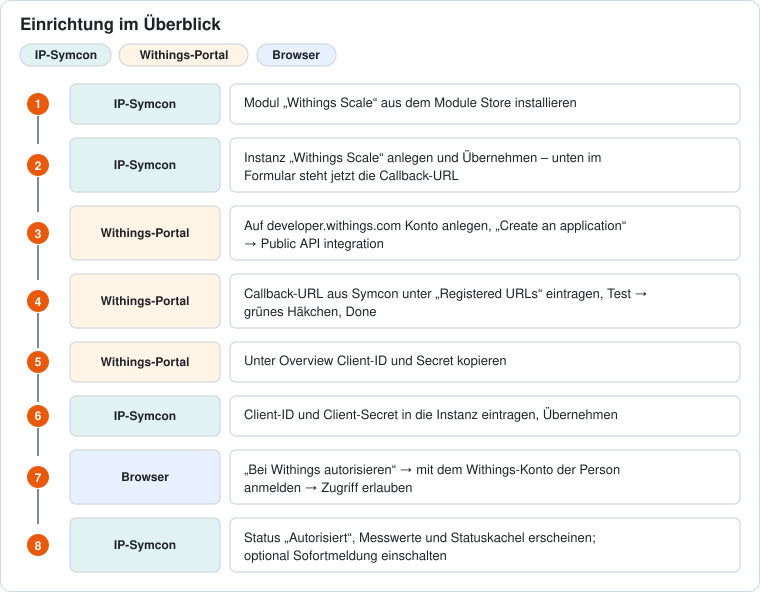

# SymconWithings

IP-Symcon-Modul für Withings-Waagen (Body, Body+, Body Smart, Body Comp, Body Scan …).

[English version](README.md)

## Module

| Modul | Beschreibung |
| --- | --- |
| [Withings Scale](WithingsScale/README.de.md) | Körpermesswerte eines Withings-Kontos, optional Statuskachel für die Kachel-Visualisierung |

## Anleitungen

* **[Withings-Entwickler-App einrichten – Schritt für Schritt](WithingsScale/ENTWICKLER-APP.md)**: Entwicklerkonto,
  App anlegen, Callback-URL, Client-ID/Secret, Autorisierung, Sofortmeldung, mehrere Personen, Betrieb ohne Symcon Connect,
  Fehlersuche – mit Bildern aller Formulare.
* [Anleitung des Moduls](WithingsScale/README.de.md): Einstellungen, Statuskachel, Variablen, PHP-Befehle.

## Einrichtung im Überblick

## Schnellstart

1. **Module Store** (Verwaltungskonsole → Korb-Symbol oben rechts) → „Withings Scale“ suchen → **Installieren**.
2. Objektbaum → **Instanz hinzufügen** → **Withings Scale** → Name z. B. „Withings Anna“ → **OK**, dann **Übernehmen**.
   Unten im Formular steht jetzt die **Callback-URL**.
3. Unter [developer.withings.com](https://developer.withings.com) eine App anlegen (**Public API integration**) und die
   Callback-URL unter **Registered URLs** eintragen ([Anleitung](WithingsScale/ENTWICKLER-APP.md#6-app-anlegen)).
4. **Client-ID** und **Client-Secret** der App in die Instanz eintragen → **Übernehmen**.
5. **Bei Withings autorisieren** klicken, mit dem Withings-Konto der Person anmelden und den Zugriff erlauben.

Alternativ zur Installation über den Store: Kern Instanzen → Modules (Module Control) → **+** →
`https://github.com/cbeham1/SymconWithings` (nicht beides gleichzeitig – der Store meldet sonst einen Konflikt).

## Lizenz

MIT, siehe [LICENSE](LICENSE).
