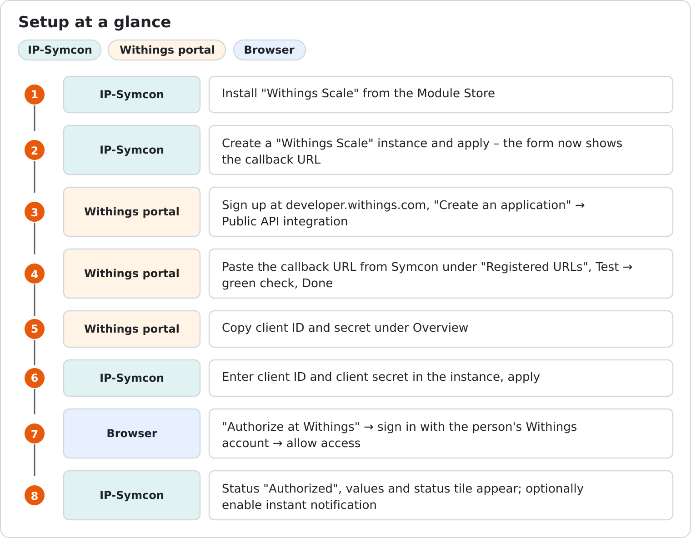

# SymconWithings

IP-Symcon module for Withings scales (Body, Body+, Body Smart, Body Comp, Body Scan …).

[Deutsche Anleitung](README.de.md)

## Modules

| Module | Description |
| --- | --- |
| [Withings Scale](WithingsScale/README.md) | Body measurements of a Withings account, optional status tile for the tile visualization |

## Guides

* **[Set up the Withings developer app – step by step](WithingsScale/DEVELOPER-APP.md)**: developer account, create the app,
  callback URL, client ID/secret, authorization, instant notification, several persons, operation without Symcon Connect,
  troubleshooting – with pictures of all forms.
* [Module documentation](WithingsScale/README.md): settings, status tile, variables, PHP functions.

## Setup at a glance

## Quick start

1. **Module Store** (management console → basket icon at the top right) → search "Withings Scale" → **Install**.
2. Object tree → **Add instance** → **Withings Scale** → name e.g. "Withings Anna" → **OK**, then **Apply**.
   The form now shows the **callback URL** at the bottom.
3. Create an app at [developer.withings.com](https://developer.withings.com) (**Public API integration**) and enter the
   callback URL under **Registered URLs** ([guide](WithingsScale/DEVELOPER-APP.md#6-create-the-app)).
4. Enter **client ID** and **client secret** of the app in the instance → **Apply**.
5. Click **Authorize at Withings**, sign in with the person's Withings account and allow access.

Instead of the Module Store you can use Module Control → **+** → `https://github.com/cbeham1/SymconWithings`
(not both at the same time – the store reports a conflict otherwise).

## License

MIT, see [LICENSE](LICENSE).
