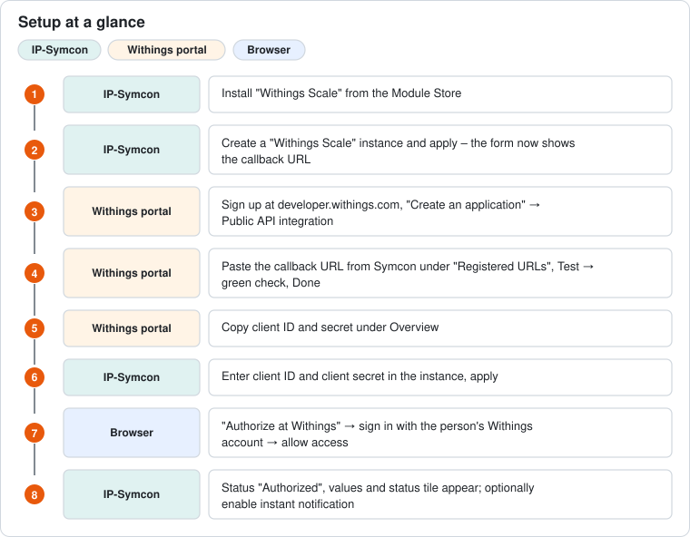
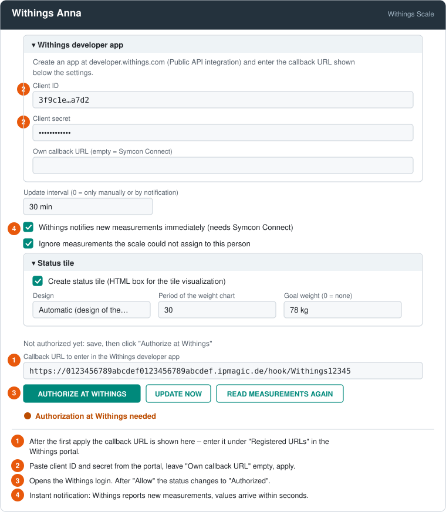
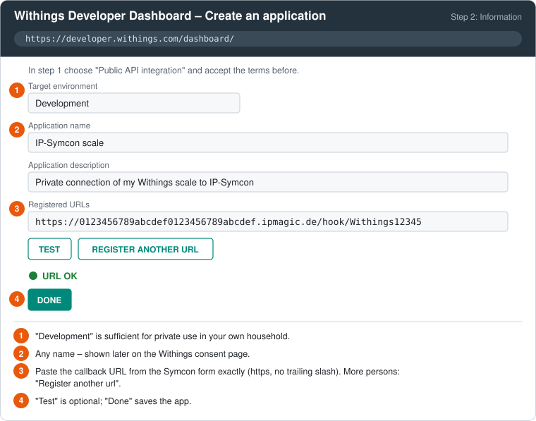
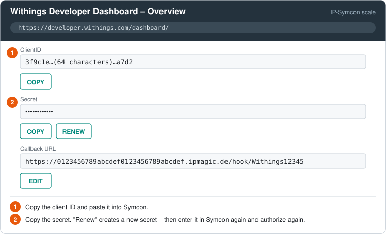

# Set up the Withings developer app (step by step)

This guide describes in detail how to create the app needed by the **Withings Scale** module in the Withings developer
portal and how to connect it to IP-Symcon.

[Back to the module documentation](README.md) · [Deutsche Version](ENTWICKLER-APP.md)

> The pictures are schematic: they show the fields and their order, the original looks slightly different.
> Client ID, secret and addresses in them are examples.

## Contents

1. [Why an own app?](#1-why-an-own-app)
2. [What you need](#2-what-you-need)
3. [Order at a glance](#3-order-at-a-glance)
4. [Install the module and create the instance](#4-install-the-module-and-create-the-instance)
5. [Developer portal account](#5-developer-portal-account)
6. [Create the app](#6-create-the-app)
7. [Enter client ID and client secret in Symcon](#7-enter-client-id-and-client-secret-in-symcon)
8. [Authorize](#8-authorize)
9. [Enable instant notification](#9-enable-instant-notification)
10. [Several persons](#10-several-persons)
11. [Without Symcon Connect](#11-without-symcon-connect)
12. [Running existing integrations (own scripts) in parallel](#12-running-existing-integrations-own-scripts-in-parallel)
13. [Security](#13-security)
14. [Troubleshooting](#14-troubleshooting)

## 1. Why an own app?

Withings only hands out measurements to registered applications (OAuth 2.0). Every application has a **client ID** and a
**client secret** and may only redirect users to previously registered **callback addresses**. As every Symcon
installation has its own address, every user creates their own (free) app. The Withings password is never stored in
Symcon – Symcon only receives access tokens that you can revoke at any time.

## 2. What you need

| What | For |
| --- | --- |
| Withings account with a scale | the account whose measurements are read (same login as in the Withings app) |
| Developer portal account | [developer.withings.com](https://developer.withings.com) – may use the same e-mail address, but is a separate account |
| IP-Symcon 7.0+ with **Symcon Connect** | Withings redirects to an https address reachable from the internet after the login |
| WebHook Control | standard in every Symcon installation; the module registers its WebHook itself |

## 3. Order at a glance



Important: **create the instance first, then the app.** The callback URL contains the instance ID and is only known
afterwards; also Withings can only test the address once the WebHook exists.

## 4. Install the module and create the instance

1. Management console → **Module Store** (basket icon at the top right) → search "Withings Scale" → **Install**.
   (Alternatively Core instances → Modules (Module Control) → **+** → `https://github.com/cbeham1/SymconWithings` –
   not both at the same time.)
2. Object tree → **Add instance** → search "Withings" → **Withings Scale**.
3. Name e.g. `Withings Anna` (the tile then shows "Anna") → **OK**.
4. At the bottom of the form you find the **callback URL**, e.g.

   ```
   https://0123456789abcdef0123456789abcdef.ipmagic.de/hook/Withings12345
   ```

   The status "Client ID and client secret missing" (red icon) is normal at this point.
   If the callback URL is missing: click **Apply** once and open the form again.

   This is what the instance looks like (picture already with the app entered; the numbers belong to steps 4, 7, 8 and 9):

   

## 5. Developer portal account

1. Open [developer.withings.com](https://developer.withings.com) → **Developer Dashboard** → **Sign up** (new account)
   or **Log in**. The developer account is independent of the normal Withings account; the same e-mail address is allowed.
2. On the first login Withings asks for an **organization** (any name, e.g. "Symcon Home"; for private use your own
   name is fine).
3. **Withings Public Cloud** must be selected at the top left.

## 6. Create the app

**Overview → Create an application.**

### Step 1 – Kind of integration

| Field | Input |
| --- | --- |
| Service | **Public API integration** |
| Terms of use | read and accept |

### Step 2 – Information

| Field | Input | Note |
| --- | --- | --- |
| Target environment | **Development** | sufficient for private use in your own household |
| Application name | e.g. `IP-Symcon scale` | any name, shown on the consent page |
| Application description | e.g. `Private connection of my Withings scale to IP-Symcon` | any text |
| Registered URLs | the **callback URL from the Symcon form**, exactly | see below |
| Project logo | optional | |

**Registered URLs:**

* Copy the address **exactly** (https, no spaces, no trailing slash).
* Click **Test**: Withings calls the address, the module answers "OK" → green check.
* For every further instance (further person) add its address with **Register another url** (see [section 10](#10-several-persons)).
* The same address is also used for the instant notification ([section 9](#9-enable-instant-notification)).

Finish with **Done**.



### Step 3 – Read the credentials

Under **Overview** the app is listed with

| Entry | Meaning |
| --- | --- |
| ClientID | long string – copy with **Copy** |
| Secret | shown hidden; copy with **Copy** or the eye icon. **Renew** creates a new secret – it must then be entered in Symcon again |
| Callback URL | the registered address(es); change with **Edit** |



## 7. Enter client ID and client secret in Symcon

1. In the instance under **Withings developer app** paste client ID and client secret.
2. Leave "Own callback URL" **empty** (the Connect address is used automatically).
3. **Apply**. The status changes to "Authorization at Withings needed".

## 8. Authorize

1. In the instance click **Authorize at Withings** – the Withings login page opens.
2. Sign in with the **Withings account of the person** (not necessarily the developer account).
3. Choose the profile if asked and **allow** access to the measurements.
4. Withings redirects back to Symcon: "Authorization successful. This window can be closed."
5. The form shows "Authorized (Withings user …)", the instance reads the measurements of the last days
   (at least 30) and creates the variables.

The code of step 4 is only valid for **30 seconds** at Withings – the redirect handles this automatically.
The module checks a random `state` value so nobody can slip in a foreign account.

## 9. Enable instant notification

Without instant notification the module polls in the set interval (default 30 min). With it Withings sends a message
after every new measurement and the values are in Symcon within seconds (e.g. in time for a morning announcement).

1. In the instance enable **Withings notifies new measurements immediately** → **Apply**.
2. The module subscribes `…/hook/Withings<ID>?n=<random token>` at Withings. The domain must be registered in the app
   under Registered URLs (it already is from step 6).
3. Check: after the next measurement the debug output of the instance shows "Notify", shortly after "getmeas".

The polling interval can stay enabled (safety net in case a notification is lost).

## 10. Several persons

* One instance per person (own Withings account).
* **One app is enough** for all persons – only add the callback URL of every instance (`…/hook/Withings<ID>`) under
  Registered URLs.
* Enter the same client ID / secret in every instance and authorize every person separately.
* Persons who only use a profile in someone else's account (e.g. children without an own account) have no own
  credentials; their measurements do not appear in the other account. Measurements the scale cannot assign to anybody
  are ignored by default.

## 11. Without Symcon Connect

Withings must reach the callback address over the internet. Without Connect there are two ways:

**a) Own address:** enter an own https address (reverse proxy, DynDNS) that forwards to
`http://<symcon>:3777/hook/Withings<ID>` under "Own callback URL" and register it in the app.

**b) Manually (not reachable):**

1. Register any address in the app, e.g. `http://localhost:3000/` (Withings marks it as "Restricted", that is fine).
2. Enter the same address in the instance under "Own callback URL" → **Apply**.
3. **Authorize at Withings** → sign in → allow. The browser then shows an error page – this is expected.
4. Copy the complete address from the address bar (`http://localhost:3000/?code=…&state=…`) and paste it **within
   30 seconds** under "Authorize manually" → **Complete authorization**.

Instant notification is not possible without a reachable address.

## 12. Running existing integrations (own scripts) in parallel

Withings replaces the **refresh token** on every refresh; the old one becomes invalid. If two integrations use the same
authorization, one throws the other out.

* Create an **own app** for the module (or at least an own authorization) – do not take over the tokens of an existing
  script.
* Only delete the old app once the old script is switched off. Deleting an app invalidates all its tokens.

## 13. Security

* Client secret and tokens are only stored in the instance (property or attributes) and never appear in the debug output.
* The WebHook only answers: empty test calls ("OK", no data), the redirect with a valid `state` and notifications with
  the random token. Everything else → 404.
* Revoke access: in the Withings app or account remove the app under the connected partner apps, or delete the app or
  renew the secret in the developer portal. Authorize again in Symcon afterwards.

## 14. Troubleshooting

| Message / behaviour | Cause | Solution |
| --- | --- | --- |
| Portal test: "Host Unreachable" | Symcon Connect not active, instance not applied yet or module older than 1.0 build 2 | check Connect, **Apply** the instance, update the module in the Module Store |
| Portal test: "Too Many Request: rate limit reached" | too many tests in a short time | wait a few minutes; the test is optional – **Done** works anyway |
| Withings page: "invalid redirect_uri" or similar | callback URL in the app differs | register the address from the Symcon form **exactly** |
| "Authorization failed" | code expired (30 s), wrong secret or state does not match (page opened twice) | check the secret, "Authorize at Withings" again |
| Status "Authorization at Withings needed" after days | refresh token invalid (access revoked, secret renewed, tokens used elsewhere) | authorize again; with parallel operation see [section 12](#12-running-existing-integrations-own-scripts-in-parallel) |
| "Request failed", debug "Withings status 401" | access token rejected | solved on the next request (token is renewed) |
| "Withings status 601" | too many requests | increase the interval |
| No new values | scale has not synchronized yet, or measurement "not assigned" | open the Withings app or assign the measurement to the person there |
| Notification does not arrive | domain not registered, Connect off | check Registered URLs, toggle the check box off/on → **Apply** (subscribes again) |

More about the API: [Withings Developer Documentation](https://developer.withings.com/api-reference).
