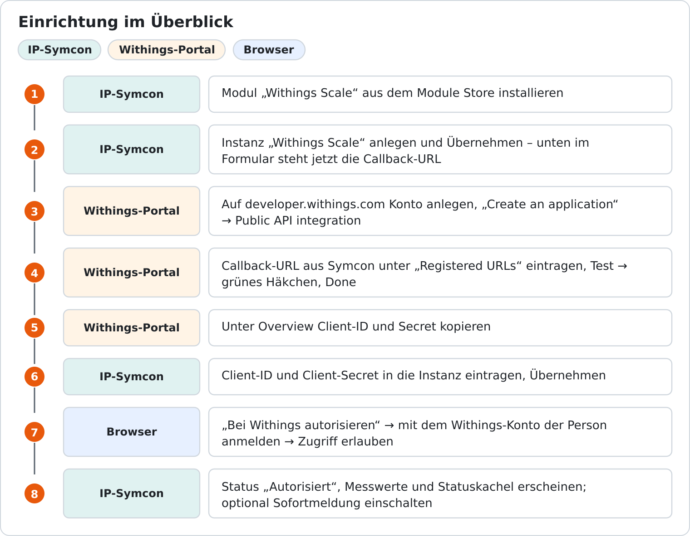

# Withings Scale

Liest die Körpermesswerte von Withings-Waagen über die Withings Health API (Cloud) und stellt sie als Variablen
und optional als Statuskachel für die Kachel-Visualisierung bereit. Eine Instanz je Withings-Konto bzw. Person.

[English version](README.md)

### Inhaltsverzeichnis

1. [Funktionsumfang](#1-funktionsumfang)
2. [Voraussetzungen](#2-voraussetzungen)
3. [Unterstützte Geräte](#3-unterstützte-geräte)
4. [Installation](#4-installation)
5. [Einrichtung der Withings-App und Autorisierung](#5-einrichtung-der-withings-app-und-autorisierung)
6. [Konfiguration](#6-konfiguration)
7. [Statuskachel](#7-statuskachel)
8. [Statusvariablen und Profile](#8-statusvariablen-und-profile)
9. [PHP-Befehlsreferenz](#9-php-befehlsreferenz)
10. [Hinweise und Fehlersuche](#10-hinweise-und-fehlersuche)

### 1. Funktionsumfang

* Gewicht, BMI, Körperfett (% und kg), fettfreie Masse, Muskelmasse, Körperwasser (kg und %), Knochenmasse, Viszeralfett,
  Grundumsatz, Stoffwechselalter, Herzfrequenz, Pulswellengeschwindigkeit, Gefäßalter, Nervengesundheit,
  extra-/intrazelluläres Wasser, Körpergröße
* Segmentwerte der Body Scan: fettfreie Masse, Fettmasse und Muskelmasse für Arme, Beine und Rumpf (abschaltbar)
* Variablen werden nur für Werte angelegt, die die Waage tatsächlich liefert
* Messungen, die die Waage nicht sicher der Person zuordnen konnte (z. B. Gäste, Kinder ohne eigenes Profil), werden ignoriert (abschaltbar)
* Optional **Statuskachel** (HTML-Box): Gewicht mit Veränderung, Körperzusammensetzung, Gewichtsverlauf, Zielgewicht; Design Automatisch/Dunkel/Hell
* Optional **Sofortmeldung** von Withings: neue Messungen sind nach wenigen Sekunden in Symcon statt erst beim nächsten Abruf (benötigt Symcon Connect)
* Anmeldung per OAuth 2.0 – Withings-Passwort wird nie in Symcon gespeichert, Tokens werden automatisch erneuert und nie im Debug ausgegeben

### 2. Voraussetzungen

- IP-Symcon 7.0 oder neuer
- Withings-Konto mit Waage
- eigene (kostenlose) App im Withings-Entwicklerportal
- für die automatische Autorisierung und die Sofortmeldung: **Symcon Connect** (alternativ eine eigene, von außen erreichbare https-Adresse)

### 3. Unterstützte Geräte

Alle Withings-Waagen, deren Messungen in der Withings-App erscheinen. Welche Werte es gibt, hängt vom Modell ab:

| Modell | Typische Werte |
| --- | --- |
| Body | Gewicht, BMI |
| Body+, Body Smart, Body Comp | zusätzlich Fett, Muskeln, Wasser, Knochen, Viszeralfett, Puls, je nach Modell Pulswellengeschwindigkeit, Gefäßalter |
| Body Scan | zusätzlich Segmentwerte, Nervengesundheit, extra-/intrazelluläres Wasser |

### 4. Installation

Verwaltungskonsole → **Module Store** (Korb-Symbol oben rechts) → „Withings Scale“ suchen → **Installieren**
(alternativ Kern Instanzen → Modules (Module Control) → **+** → `https://github.com/cbeham1/SymconWithings`).
Danach „Instanz hinzufügen“ → **Withings Scale**. Für jede Person (eigenes Withings-Konto) eine eigene Instanz anlegen.

Tipp: Die Instanz „Withings `<Name>`“ nennen, z. B. „Withings Anna“ – die Kachel zeigt dann „Anna“.

### 5. Einrichtung der Withings-App und Autorisierung

**Ausführliche Schritt-für-Schritt-Anleitung mit allen Feldern des Entwicklerportals, mehreren Personen, Betrieb ohne
Connect und Fehlersuche: [ENTWICKLER-APP.md](ENTWICKLER-APP.md).** Kurzfassung:




1. Instanz anlegen und **Übernehmen** – das Formular zeigt unten die **Callback-URL**, z. B.
   `https://xxxx.ipmagic.de/hook/Withings12345`.
2. Auf [developer.withings.com](https://developer.withings.com) anmelden und eine Anwendung anlegen
   (**Public API integration**, Name und Beschreibung frei wählbar) und die Callback-URL unter **Registered URLs** eintragen.
3. Client-ID und Client-Secret der App in die Instanz eintragen und **Übernehmen** klicken.
4. In der Instanz **Bei Withings autorisieren** klicken, mit dem Withings-Konto der Person anmelden und den Zugriff erlauben.
   Es erscheint „Autorisierung erfolgreich“. Die Instanz liest nun die Messungen der letzten Tage (mindestens 30) ein.

**Ohne Symcon Connect:** Unter „Eigene Callback-URL“ eine Adresse eintragen, die auf `/hook/Withings<InstanzID>` dieses
Symcon-Servers weiterleitet. Alternativ eine beliebige in der App eingetragene Adresse verwenden und unter
„Manuell autorisieren“ die Adresse, auf die Withings weitergeleitet hat, **innerhalb von 30 Sekunden** einfügen
(Withings-Codes verfallen sehr schnell).

**Wichtig bei mehreren Integrationen:** Withings ersetzt das Erneuerungs-Token bei jeder Erneuerung. Nutzen zwei
Integrationen (z. B. dieses Modul und ein eigenes Skript) dieselbe Autorisierung, verliert eine davon den Zugang.
Für jede Integration eine eigene App bzw. eigene Autorisierung verwenden.

### 6. Konfiguration

| Name | Beschreibung |
| --- | --- |
| Client-ID / Client-Secret | Zugangsdaten der Withings-App |
| Eigene Callback-URL | leer = Symcon-Connect-Adresse + WebHook (empfohlen) |
| Abfrageintervall | Minuten zwischen zwei Abrufen (Standard 30, 0 = nur manuell bzw. per Sofortmeldung) |
| Withings meldet neue Messungen sofort | Abonniert die Benachrichtigung von Withings; neue Messung → Abruf nach ca. 3 s |
| Messungen ignorieren, die … nicht sicher zugeordnet | Standard an; verhindert Werte von Gästen |
| Segmentwerte anlegen | Arme, Beine, Rumpf (nur Body Scan) |
| Körpergröße für den BMI | in cm; 0 = Größe aus Withings |
| Statuskachel anlegen | Variable „Statuskachel“ (HTML-Box), Standard an |
| Design | Automatisch (Design der Kachel-Visualisierung, sonst Hell/Dunkel des Geräts), Dunkel, Hell |
| Zeitraum des Gewichtsverlaufs | 7–365 Tage (Standard 30) |
| Zielgewicht | in kg; 0 = keines |
| Bei Withings autorisieren | öffnet die Anmeldeseite von Withings |
| Jetzt aktualisieren | liest neue Messungen sofort |
| Messwerte neu einlesen | verwirft die gespeicherten Werte und liest die letzten Tage erneut |

### 7. Statuskachel

Die Variable **Statuskachel** in die Kachel-Visualisierung ziehen (empfohlen: hohe Kachel, z. B. 2×3). Sie zeigt:

* Name, Zeitpunkt der letzten Messung (älter als 7 Tage → orange)
* Gewicht groß, darunter Veränderung seit der letzten Messung, im gewählten Zeitraum und Abstand zum Zielgewicht
* bis zu sechs Werte: BMI, Körperfett, Muskeln, Wasser, Knochen, Viszeralfett (bzw. Puls, Stoffwechselalter)
* Gewichtsverlauf als Linie mit Zielgewicht (gestrichelt) und Min./Max.

Der Verlauf wird in der Instanz gespeichert (bis zu 2000 Messungen) und braucht kein Archiv.

### 8. Statusvariablen und Profile

| Ident | Name | Typ | Profil |
| --- | --- | --- | --- |
| Tile | Statuskachel | String | ~HTMLBox |
| LastMeasurement | Letzte Messung | Integer | ~UnixTimestamp |
| Weight | Gewicht | Float | WTH.Kilogram |
| BMI | BMI | Float | WTH.BMI |
| FatRatio | Körperfett | Float | WTH.Percent |
| FatMass | Fettmasse | Float | WTH.Kilogram |
| FatFreeMass | Fettfreie Masse | Float | WTH.Kilogram |
| MuscleMass | Muskelmasse | Float | WTH.Kilogram |
| Hydration | Körperwasser | Float | WTH.Kilogram |
| HydrationRatio | Körperwasseranteil | Float | WTH.Percent |
| BoneMass | Knochenmasse | Float | WTH.Kilogram |
| VisceralFat | Viszeralfett | Float | WTH.Index |
| BMR | Grundumsatz | Integer | WTH.Kcal |
| MetabolicAge | Stoffwechselalter | Integer | WTH.Years |
| HeartRate | Herzfrequenz | Integer | WTH.BPM |
| PulseWaveVelocity | Pulswellengeschwindigkeit | Float | WTH.Speed |
| VascularAge | Gefäßalter | Integer | WTH.Years |
| NerveHealth | Nervengesundheit | Integer | WTH.Score |
| ExtracellularWater | Extrazelluläres Wasser | Float | WTH.Kilogram |
| IntracellularWater | Intrazelluläres Wasser | Float | WTH.Kilogram |
| Height | Körpergröße | Float | WTH.Meter |
| z. B. MuscleMassLeftArm | Muskelmasse linker Arm | Float | WTH.Kilogram |

Segment-Idents: `FatFreeMass`/`FatMass`/`MuscleMass` + `RightArm`/`LeftArm`/`LeftLeg`/`RightLeg`/`Trunk`.

Profile des Moduls: `WTH.Kilogram`, `WTH.Percent`, `WTH.BMI`, `WTH.Index`, `WTH.Meter`, `WTH.Speed`, `WTH.Kcal`, `WTH.BPM`, `WTH.Years`, `WTH.Score`.

Die Werte werden zum Zeitpunkt des Abrufs geschrieben; der Messzeitpunkt steht in „Letzte Messung“. Wer die Werte
archivieren möchte, aktiviert die Archivierung der gewünschten Variablen wie gewohnt im Archive Control.

Das Modul registriert den WebHook `/hook/Withings<InstanzID>` (wird beim Löschen der Instanz entfernt). Er beantwortet nur
die Rückleitung der Autorisierung (mit Prüfung des state-Werts) und Sofortmeldungen mit einem zufälligen Token.

### 9. PHP-Befehlsreferenz

`bool WTH_Update(int $InstanzID);`
Liest neue Messungen und aktualisiert Variablen und Kachel.

`bool WTH_Reload(int $InstanzID);`
Verwirft die gespeicherten Werte und den Verlauf und liest die letzten Tage erneut ein.

`string WTH_GetAuthorizationURL(int $InstanzID);`
Liefert die Adresse der Withings-Anmeldeseite.

`bool WTH_CompleteAuthorization(int $InstanzID, string $Code);`
Schließt die Autorisierung mit dem Code bzw. der weitergeleiteten Adresse ab (innerhalb von 30 Sekunden).

Beispiel: Morgendurchsage erst nach frischem Abruf

```php
WTH_Update(12345);
$gewicht = GetValue(IPS_GetObjectIDByIdent('Weight', 12345));
```

### 10. Hinweise und Fehlersuche

| Status / Meldung | Ursache und Abhilfe |
| --- | --- |
| Client-ID und Client-Secret fehlen | Zugangsdaten der Withings-App eintragen |
| Autorisierung bei Withings erforderlich | „Bei Withings autorisieren“ klicken; nach Widerruf in der Withings-App oder Nutzung durch eine andere Integration erneut nötig |
| Abfrage fehlgeschlagen | Debug-Ausgabe der Instanz ansehen (Withings-Statuscode); Internetverbindung prüfen |
| Autorisierung schlägt fehl | Callback-URL in der Withings-App genau so eintragen, wie sie im Formular steht |
| Keine Werte nach der Messung | Waage hat noch nicht synchronisiert (Withings-App öffnen) oder Messung war „nicht zugeordnet“ – in der Withings-App der Person zuweisen |
| Sofortmeldung kommt nicht | Symcon Connect aktiv? Callback-URL in der Withings-App eingetragen? |
