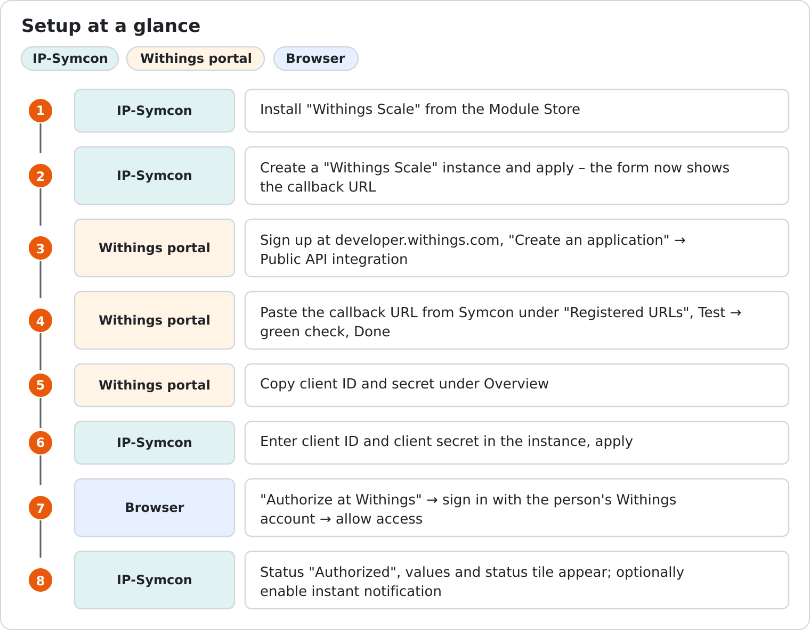

# Withings Scale

[Deutsche Anleitung](README.de.md) · **[Developer app step by step](DEVELOPER-APP.md)**

Reads the body measurements of Withings scales (Body, Body+, Body Smart, Body Comp, Body Scan, …) through the Withings Health API.
One instance per Withings account (person).

## Features

- Weight, BMI, body fat, fat mass, fat free mass, muscle mass, body water (kg and %), bone mass, visceral fat,
  basal metabolic rate, metabolic age, heart rate, pulse wave velocity, vascular age, nerve health score,
  extracellular/intracellular water, height
- Segmental values of the Body Scan (fat free mass, fat mass and muscle mass of arms, legs and trunk)
- Variables are only created for values the scale actually measures
- Optional status tile (HTML box) for the tile visualization: weight with changes, body composition, weight chart, goal weight; design automatic/dark/light
- Optional push notification of Withings: new measurements arrive within seconds (needs Symcon Connect)
- Measurements the scale could not assign to the person (e.g. guests) are ignored (configurable)

## Installation

Management console → **Module Store** (basket icon at the top right) → search "Withings Scale" → **Install**
(or Module Control → **+** → `https://github.com/cbeham1/SymconWithings`, not both).

## Setup

Detailed guide with pictures of all forms: **[DEVELOPER-APP.md](DEVELOPER-APP.md)**.



1. Create the instance "Withings Scale" and apply. The form shows the callback URL (Symcon Connect URL + `/hook/Withings<InstanceID>`).
2. Create an app at [developer.withings.com](https://developer.withings.com) (Public API integration) and register the callback URL.
3. Enter client ID and client secret of the app in the instance and apply.
4. Click "Authorize at Withings", sign in and allow access. The window confirms the authorization.

Without Symcon Connect enter an own callback URL that leads to the WebHook, or any registered URL and complete the authorization manually
(paste the redirected address within 30 seconds – Withings codes expire quickly).

Each Withings authorization has its own tokens. A refresh token that is used by another integration with the same app becomes invalid when that integration refreshes it;
use one authorization per integration.

## Functions

```php
WTH_Update(int $InstanceID): bool                       // read new measurements
WTH_Reload(int $InstanceID): bool                       // forget stored values and read the last days again
WTH_GetAuthorizationURL(int $InstanceID): string        // URL of the Withings authorization page
WTH_CompleteAuthorization(int $InstanceID, string $Code): bool
```

## Notes

- Values are written with the time of the update; the time of the measurement is in the variable „Last measurement“.
- The weight history of the tile is stored in the instance (up to 2000 measurements).
